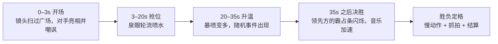
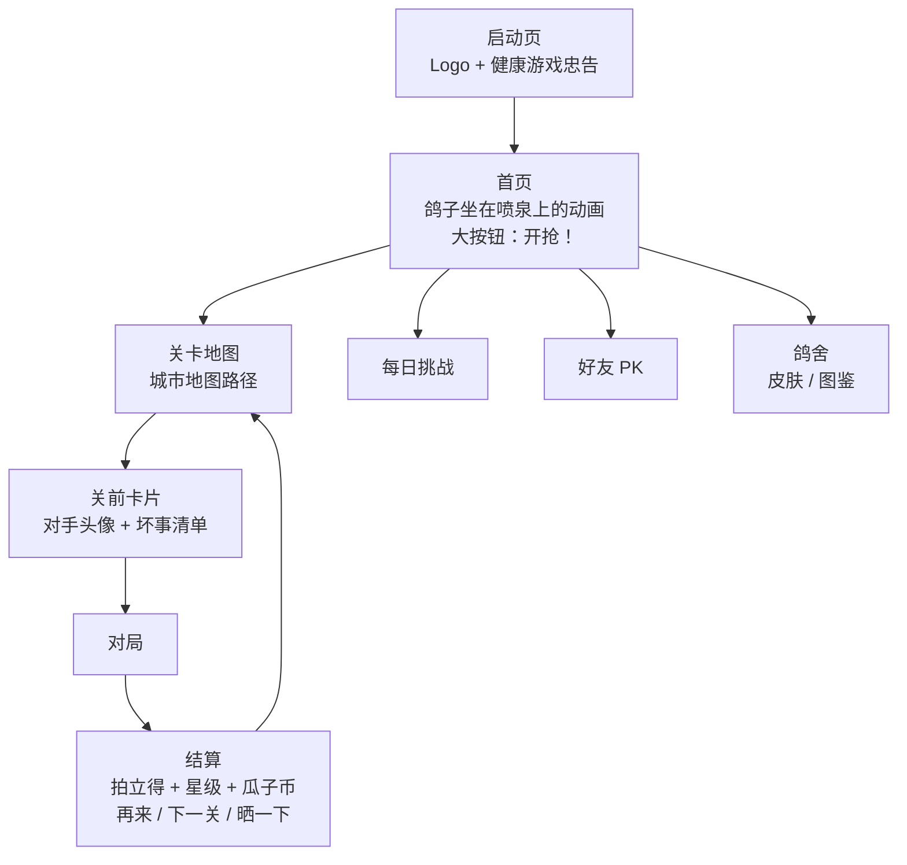
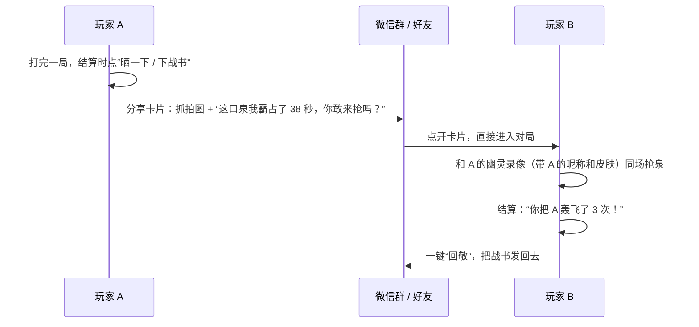

# 《坏鸽子抢喷泉》完整开发计划（微信小游戏首发 · main 分支）

> 版本：v1.0（2026-11-23）
> 用法：**这份文档就是给本地开发 AI（Gemini）的总纲**。每次开发前先让它读一遍，并且一次只做一个里程碑。
> 分支：`main`（`v2.0-arcade`）。`prototype/fountain-launch` 冻结，不再开发。

---

## 0. 先看现状：截图暴露了哪些问题

| # | 问题 | 现象（截图） | 为什么伤游戏 |
| --- | --- | --- | --- |
| 1 | **定位写错** | 首页副标题写着“怒鸟式弹射破坏” | 第一眼就告诉玩家“我是山寨” |
| 2 | **首页是一张说明书** | 3 行按键说明、Stage 文案、4 张关卡卡片挤在一个白色卡片里 | 手游玩家不看字；首页要做到 **1 秒能点“开抢”** |
| 3 | **手机上显示键盘提示** | “A/D 移动 · W 小跳 · Space 猛顶”、按钮上标着 (W)、(Space) | 一看就是网页 demo，不像手游 |
| 4 | **画面 60% 是空的** | 天空占了上半屏，鸽子和喷泉挤在下面一条窄带里 | 主角太小，表情、喜剧感都看不清 |
| 5 | **目标太容易，没有紧张感** | 第 1 关还剩 14s 时已经 667/350，**一半时间就过关了** | 后半局没有任何悬念 |
| 6 | **得分方式等于挂机** | 坐在水柱里就按秒加分 | 最优解是一动不动，“抢”的动作不再被需要 |
| 7 | **对手的压力看不见** | 只显示自己的分数，看不到白鸽“快赢了” | 没有被追赶的感觉，“抢”无从谈起 |
| 8 | **反馈弱** | “太坏了！+150”是灰色半透明字；没有震屏、慢动作、挤压回弹 | 最该爽的瞬间没有爽到 |
| 9 | **视觉像网页表单** | 后台系统风格的圆角卡片、蓝色按钮，没有 logo 也没有角色展示 | 截图不会有人想转发 |
| 10 | **4 个按钮的双拇指操作** | 左右键 + 两个技能键 | 对微信的轻度用户门槛偏高 |

> **结论**：底层（物理、状态机、AI、存储层）可以留着用，**规则、操作、画面、UI 这四层需要重做**。这不是推倒重来，而是“同一个玩法，做成真正的游戏”。

---

## 1. 愿景与设计原则

**一句话**：一款**和朋友互相使坏**的鸽子喷泉乱斗。一个人玩也像在和真人抢，转发给朋友就是下战书。

**三条设计原则（每个功能至少满足其中两条）**

1. **抢**：场上永远有对手和你争同一口泉。
2. **坐**：屁股是主要动作（坐、墩、堵、顶）。
3. **坏**：使坏有奖励，而且好笑、值得截图。

**目标用户**：微信里有碎片时间的轻度玩家，男女都有。**单局 40–60 秒，单手就能玩，3 秒能看懂。**

**明确不做**：弹射；陌生人实时匹配（v1 不做）；内购（个人主体不允许）；“分享得奖励”（违反微信的诱导分享规范）。

---

## 2. 核心玩法重设计

### 2.1 胜负规则：从“得分门槛”改成“霸占条赛跑”

- 每只鸽子（包括对手）头顶或 HUD 上都有一根**霸占条（0–100）**。
- 坐在**喷水中的水柱核心区**，霸占条就会上涨；连续霸占有 ×2、×3 加速（复用现有的连击机制）。
- **谁先涨满谁赢**；时间到了就比谁的条更长。单局上限 60 秒，正常 35–50 秒分出胜负。
- 被顶开、被暴喷轰飞的时候不涨条；**被暴喷轰飞还会掉 10 点**。
- **去掉“羽毛 3 条命”**：失败的方式只有一种，就是“被抢先了”，规则更简单。
- 分数保留，但**只用于每日挑战和无尽模式的排行**，不再作为闯关的过关条件。

> 好处：对手的条在涨，就是看得见的压力，“抢”的感觉自然就出来了；后半局也一直有悬念，因为随时可能被反超。

### 2.2 四个动作（v1 只有这四个）

| 动作 | 说明 | 状态 |
| --- | --- | --- |
| **坐 / 霸占** | 移动到喷水的水柱上，自动坐上去被托起来；水柱有侧向推力，需要微调才能坐稳 | 已有，调参 |
| **顶** | 向最近的对手撞过去：命中让对手眩晕 0.6s，并把它推出水柱 | 已有 |
| **墩 / 堵泉** ⭐ | 跳起来落到**一个没在喷水的泉眼**上，就会**一屁股把它堵住**（最多堵 2.0s）。被堵住的水压会**转到左右相邻的泉眼**，让它们立刻暴喷，把坐在上面的对手轰上天 | **新增，主要的原创点** |
| **躲暴喷** | 泉眼亮红色“!”预警之后会暴喷，坐在上面的鸽子会被轰飞 | 已有 |

**堵泉的细节（初始值，后续以平衡模拟结果为准）**
- 能堵的条件：泉眼处于 `IDLE` 或 `WARNING` 状态，玩家从空中落在泉眼核心区 ±20px 以内。
- 憋压表现：屁股发抖、泉眼周围的格栅冒泡、相邻泉眼的水花越来越高、音调逐渐上升。
- 松开：玩家主动离开，或者满 2.0s 自动弹开。
  - 憋压 **0.6s 以上**：相邻泉眼暴喷。
  - 憋满 2.0s：叫**“憋大招”**，左右两边都暴喷，玩家自己被弹到高处，霸占条 +8，屏幕弹出“坏到家了！”。
- 冷却：同一只鸽子 3.0s 内不能再堵。
- **对手也会堵泉**（从第 2 章开始），所以玩家要学会“别坐在对手旁边的泉眼上”。

### 2.3 操作：从 4 个按钮改成“拖动 + 一个动作键”

- **左手**：在屏幕下半区**任意位置按住左右拖动**，鸽子就朝手指所在的横坐标走过去（有最高速度限制）。
- **右手**：右下角一个**大的动作键**，按当前情境自动判断做什么：
  - 70px 内有对手：**顶**
  - 在地面、附近没有对手：**跳**
  - 在空中：**下墩**（落在空闲泉眼上就是堵泉）
- 网页版保留键盘操作：A/D 移动，Space 动作，W 跳。**只有检测到用键盘时才显示键盘提示。**
- 设置里保留“经典四键”选项，用来做 A/B 对比。

### 2.4 一局的节奏模板（40–60s）



---

## 3. 游戏感（手感和反馈）规范

**画面比例**：逻辑分辨率保持 390×640，但要**重新排布**：
- 格栅（地面泉眼）放到 y≈440；**鸽子半径从 22 放大到 30–32**；水柱最高 220px，填满中部画面。
- 天空压缩成背景楼群加远景（做 2–3 层视差）。
- **有鸽子被轰到高处时**，镜头轻微拉远并跟随（缩放 1.0 → 0.85），落地后回到原位。

**反馈清单（每一项都要实现）**

| 时刻 | 反馈 |
| --- | --- |
| 坐上水柱 | 屁股压扁再回弹（压到 0.85 再弹回）、水花溅起、“咕~”一声 |
| 顶到对手 | 停顿 70ms、屏幕震 3px/0.1s、对手眼睛变成 `> <`、几根羽毛飞出 |
| 暴喷轰飞 | 屏幕震 5px/0.15s、被轰的鸽子在空中旋转并挥动翅膀、落地砸出尘土、**“太坏了！”大字（黄底黑描边）** |
| 堵泉憋压 | 屁股抖动的幅度随时间增大、音调上升、相邻泉眼冒泡并闪光 |
| 憋大招 | **0.3s 慢动作**、镜头拉近、“坏到家了！”，**同时自动抓拍这一帧** |
| 霸占条快满（>80） | 条开始闪烁、心跳音效、背景音乐加快 |
| 胜利 | 胜者在水柱顶端摆出得意表情，其余鸽子围观；拍立得“咔嚓”定格 |
| 失败 | 玩家的鸽子湿漉漉地瘫坐、头顶冒出一朵乌云，配一个搞笑音效 |

**飘字规则**：只用**一种**风格（黄底、黑描边、圆体粗字），同时最多出现 2 条；**不要用灰色半透明字**。

---

## 4. 美术与 UI 方向

### 4.1 美术规范（先写定，后面所有新内容都按它来）

- **风格**：街头贴纸 + 手绘漫画。**所有物体都有 3px 深色描边**，色块平涂，加一层简单的亮面。
- **调色板**：暖色天空（偏杏色），喷泉用高饱和青蓝，警示统一用番茄红，强调统一用芥末黄，描边统一用 #2B2B3A。**整个游戏只用这一套颜色。**
- **字体**：标题和按钮用一款**可以免费商用**的圆体粗字（例如站酷快乐体或阿里巴巴普惠体 Heavy，**使用前请确认许可**），只打包用到的字（字体子集化，控制在 300KB 以内）。
- **角色**：
  - 头身比 1:1，眼睛占脸的 1/3。
  - 黑小坏的招牌表情是**眯眼坏笑**。白胖是“理所当然霸座”的表情，麻雀是贱笑，红冠是怒目。
  - 状态动画：待机呼吸、走路两帧、坐着漂浮、眩晕、被轰飞旋转、得意、湿身瘫坐。
  - **继续用 Canvas 程序绘制**：好处是能做挤压回弹，换皮肤只需改颜色和挂件参数，包体也小。
- **背景**：每个广场一张预渲染的 PNG（可以用 AI 生图，再人工统一色调和描边），单张控制在 200KB 以内，放进分包。

### 4.2 页面结构



- **首页**：上半屏是 logo，中间是**鸽子抢泉的实时演示**（就是游戏场景本身，让 AI 自己对打），下方一个大的“开抢！”按钮，底部一排 3 个图标按钮。**不放任何说明文字。**
- **新玩家第一次打开，直接进入第 1 关**，不经过首页。
- **对局 HUD**：
  - 左上：玩家头像和霸占条；右上：对手头像和霸占条（最多 3 个，对手多时用缩小版）。
  - 中间上方：剩余时间。右上角：暂停。
  - **不显示“315/350”这种数字。**
- **教学**：一关只教一件事，用场景里的手指动画和一句短提示（不超过 8 个字），例如“拖动 → 走过去”“点 → 顶开它”。
- **结算**：拍立得照片（本局最坏的一刻）+ 吐槽文案 + 星星逐颗亮起的动画 + 瓜子币；按钮“下一关”“再来”“晒一下”。

---

## 5. 内容结构

### 5.1 v1 上线的内容范围

| 模式 | 内容 | 作用 |
| --- | --- | --- |
| **闯关** | 3 章 × 8 关，共 24 关 | 新手引导和成长主线 |
| **每日挑战** | 全国同一个随机种子，每天一关加特殊规则 | 每天回来的理由，群里有共同话题 |
| **好友 PK** | 转发一个链接，朋友打开后**和你的幽灵录像抢泉** | 传播的主循环 |
| **鸽舍** | 皮肤（用瓜子币买）+ 坏事图鉴（成就） | 收集和展示 |

> v1.1 再加“广场巡回”肉鸽模式（5–7 场 + 三选一词条 + Boss 场）。v1 的内容范围已经足够验证留存。

> **关卡是成长的骨架，不是留人的主力**。留人靠每日挑战、好友 PK 和收集；关卡只负责把机制教会，让玩家看到完整的世界观。

### 5.2 章节设计（每章教 1–2 个新东西，第 8 关是 Boss 关）

| 章 | 广场 | 新机制 | 对手 | 特殊事件 | Boss |
| --- | --- | --- | --- | --- | --- |
| 1 | 小区街角 | 坐 → 顶 → 暴喷 → 堵泉（第 1–4 关各教一个） | 白胖 | 大爷撒米（地上掉玉米粒） | **白胖老大**：体型大、推不动，必须靠堵泉把它轰走 |
| 2 | 公园音乐喷泉 | 喷泉跟着音乐节拍喷、32° 斜喷 | 麻雀群（体轻、成群、爱偷位置） | 汽水喷泉（重力减半） | **麻雀帮**：5 只一起上 |
| 3 | 商业街网红地泉 | 移动泉眼（扫地机器人背着泉眼跑） | 红冠（蓄力冲撞） | 网红拍照（闪光一亮，这一刻霸占加倍） | **鸽王**：会堵泉、会冲撞 |

### 5.3 关卡数据格式（Gemini 要按这个结构实现）

```ts
interface LevelDef {
  id: string;                 // 'c1-l4'
  plaza: PlazaId;             // 背景和地形
  nozzles: NozzleDef[];       // 位置、类型（普通/斜喷/移动）
  pattern: PatternId;         // 喷泉节奏表（可以跟随节拍）
  rivals: { kind: AiArchetype; tier: 1|2|3|4|5 }[];
  events: EventDef[];         // 什么时候触发什么事件
  rules: RuleModifier[];      // 低重力 / 下雨 / ...
  durationSec: number;        // 上限 60
  goals: [Goal, Goal];        // 坏事清单：第 2、3 颗星的条件
  teach?: TutorialStep[];     // 教学步骤
}
```
所有关卡写在 `src/content/levels/*.json`（或 `.ts`）里，**新增关卡不需要改代码**。

### 5.4 坏事清单（星级）示例

- ★：赢了
- ★★：把白胖轰飞 2 次 / 一次都没被暴喷 / 吃到 3 颗玉米
- ★★★：憋一次大招 / 30 秒内获胜 / 霸占条全程领先

---

## 6. 难度设计

### 6.1 可调的难度参数（全部集中放在 `tuning` 里）

| 参数 | 第 1 章 | 第 2 章 | 第 3 章 | Boss 关 |
| --- | --- | --- | --- | --- |
| 对手 AI 等级 | 1–2 | 2–3 | 3–4 | 高一级 |
| AI 反应延迟 | 0.55s → 0.40s | 0.40s → 0.32s | 0.32s → 0.25s | −0.05s |
| 对手霸占条上涨速度 | 0.7 → 0.9 倍 | 0.9 → 1.0 倍 | 1.0 → 1.1 倍 | 1.1 倍 |
| 对手数量 | 1 | 2–3（麻雀算 0.5 个） | 2–3 | 见 Boss 设计 |
| AI 会堵泉 | 否 | 等级 3 起 | 是 | 是 |
| 暴喷概率 | 低 | 中 | 中高 | 高 |

**AI 等级的含义**：
- 等级 1：只会走向最近的水柱。
- 等级 2：会顶人。
- 等级 3：会躲暴喷、会堵泉。
- 等级 4：会预判泉眼下一次在哪里喷。
- 等级 5：会故意坐在玩家旁边，等玩家去堵泉时反过来坑玩家。

### 6.2 难度曲线：锯齿形

每章开头先降一点难度，章内逐步上升，Boss 关是峰值；下一章开头再降回来，接着介绍新机制。

**首次挑战的目标胜率**：
- 第 1–3 关 ≥ 95%
- 第 1 章平均 80%
- 第 1 章 Boss 55%
- 第 2 章平均 70%
- 第 3 章平均 60%

### 6.3 用平衡模拟来验证（不要靠感觉调）

- 写一个**机器人玩家**，分三档水平：新手（反应 0.6s，只会坐）、普通（会顶会躲）、高手（会堵泉）。
- 用无界面的 `rules` 和 `world` 在**固定随机种子**下批量跑，**每关 500 局**，输出每档的胜率表。这一步需要先把物理改成确定性的（见 7.2）。
- 写一个 `npm run balance` 命令，每次改了参数就跑一遍；胜率偏离目标 ±10% 就是失败。

### 6.4 动态难度（悄悄帮玩家）

- 同一关**连输 2 次**：对手的反应延迟悄悄加 0.08s。
- **连输 3 次**：弹出“胖大肥来助阵”（看一次激励视频，派一只胖鸽当友军帮你挡位置），或者“跳过本关”（也是看激励视频）。
- 一旦赢了，就把动态难度的调整清零。

---

## 7. 技术架构

### 7.1 目录重构（M0 完成）

```
src/
  core/        rng.ts（带种子的随机数）, loop.ts, input.ts（统一触屏/键盘）, replay.ts
  sim/         rules.ts, world.ts, ai/（每个对手一个文件）, nozzle.ts, plug.ts（堵泉）
  content/     levels/, plazas/, skins/, strings.zh.ts
  render/      camera.ts, fx/（震屏、慢动作、粒子）, actors/（鸽子绘制）, hud.ts
  scenes/      splash, home, map, prelevel, play, result, daily, pk, coop（鸽舍）
  platform/    index.ts（接口定义）, web/, wx/
               storage, audio, share, ads, rank, user, analytics, haptics, font
  meta/        economy.ts（瓜子币）, progress.ts, achievements.ts
tools/         balance.ts（批量平衡模拟）
```
- 现在的 `painter.ts`（48KB）要按场景和角色拆开，**单个文件不超过 600 行**。

### 7.2 确定性（这是排行榜、回放、幽灵录像、平衡模拟共同的基础）

- **模拟逻辑里禁止使用 `Math.random()`**，全部改用 `core/rng.ts`（mulberry32 算法，带种子）。特效粒子可以用另一个独立的随机源。
- 固定步长保持 1000/60 ms；模拟只依赖“种子 + 每帧输入”这两样东西。
- 回放 = 种子 + 关卡 ID + 输入变化记录（只记有变化的帧）。50 秒一局应该小于 2KB。
- 测试要求：同样的种子和输入，跑两次的最终状态**哈希值必须完全相同**。

### 7.3 平台层

| 接口 | 网页版实现 | 微信版实现 |
| --- | --- | --- |
| storage | localStorage | `wx.setStorageSync` |
| share | 网页分享接口 / 复制链接 | `wx.shareAppMessage`（带 query 参数 + 抓拍图） |
| ads | 不实现（空函数） | 激励视频 / 插屏 |
| rank | 本地 | 开放数据域：好友排行 / 群排行 |
| cloud | 不实现，或接轻量后端 | 微信云开发：保存幽灵录像、每日挑战排行 |
| analytics | console 输出 | 微信自定义分析：`wx.reportEvent` |

> [!WARNING]
> 微信这边几项具体能力（**群排行接口目前是否还能用、云开发现在的收费方式、主包和总包的大小上限、分享卡片 query 参数的长度上限**）在接入前都要先查微信官方开发文档，按当时的版本来。

### 7.4 性能和包体
- 首包控制在 **2MB 以内**（字体子集 + 代码 + 第 1 章素材），其他章节放进分包。
- 在千元安卓机上稳定 60fps；同屏粒子不超过 150 个。

---

## 8. 留存与传播（关键）

### 8.1 传播主循环：好友 PK 幽灵录像


- 幽灵录像就是 A 那一局的回放：A 的鸽子在场上当对手，和 B 抢同一组泉眼。
- 昵称和头像要用微信的“头像昵称填写”组件，**用户主动填了才能用**；没填的话显示“神秘坏鸽”。
- **这是把单机游戏变成“有人和我抢”的最便宜办法**，而且每一次分享都是一个能直接玩的入口。

### 8.2 其他留存机制

| 机制 | 怎么做 | 留住哪一层 |
| --- | --- | --- |
| 每日挑战 | 每天一个种子 + 一条特殊规则；免费 3 次，看广告再加 1 次；有好友排行 | 每天回来 |
| 抓拍海报 | 系统自动记录本局“最坏的一刻”（轰飞最高、憋大招、反超的那一帧），配上吐槽文案 | 传播 |
| 皮肤 | 墨镜、金链子、大妈头巾、外卖头盔……用瓜子币买，**在幽灵录像和海报里朋友也能看到** | 收集和炫耀 |
| 坏事图鉴 | 例如“一屁股憋飞三只”“被自己堵的泉炸飞”，配搞笑插画 | 长期目标 |
| 首胜奖励 | 每天第一次胜利，瓜子币 ×2 | 每天回来 |

### 8.3 合规红线
- **不能给分享发奖励**，比如“分享得金币”或“分享解锁关卡”。微信认定这是诱导分享，会被处罚。
- 激励视频可以给奖励，但必须是玩家自愿看的。
- 没有内购入口，也不显示任何价格。

---

## 9. 广告变现（激励视频为主，克制使用）

| 广告点 | 类型 | 触发时机 |
| --- | --- | --- |
| 失败后“再给 10 秒” | 激励视频 | 输了，且霸占条差距在 20 点以内 |
| 胖大肥助阵 / 跳过本关 | 激励视频 | 同一关连输 3 次 |
| 结算瓜子币 ×3 | 激励视频 | 每局结算时可选 |
| 每日挑战加 1 次 | 激励视频 | 免费的 3 次用完之后 |
| 插屏 | 插屏广告 | **每 3 局最多 1 次，新用户前 10 分钟完全不出** |

不做 banner 广告。开流量主的门槛是累计访客 ≥ 500，所以**广告相关代码 v1 就写好接口，等开通后再打开**。

---

## 10. 里程碑与检查点

> 时长按“你每天花 1–2 小时 + Gemini 开发”估算。**每个阶段的检查点没过，就不进下一阶段。**

| 里程碑 | 周期 | 内容 | 检查点 |
| --- | --- | --- | --- |
| **M0 打地基** | 第 1 周 | 目录重构、带种子的随机数和回放、平台层、输入统一、修首页定位文案、手机端去掉键盘提示 | 测试全部通过；同种子回放哈希一致；画面和现在完全一样（纯重构，不改行为） |
| **M1 好玩** | 第 2–4 周 | 霸占条赛跑、堵泉、拖动 + 动作键、画面重新排布和镜头、反馈清单、3 种对手的个性 AI | **5–8 人试玩**：60% 以上的人主动再来一局；能说出“堵泉”是什么；会笑 |
| **M2 好看** | 第 5–6 周 | 美术规范落地、角色重绘、3 张广场背景、全部页面重做、抓拍结算 | 截图发给 5 个没玩过的人，问“想不想点开”，3 人以上回答想；千元机 60fps |
| **M3 内容和难度** | 第 7–9 周 | 24 关、教学、坏事清单、平衡模拟工具、动态难度 | `npm run balance` 胜率达到目标；新人从第 1 关打到第 4 关的比例 ≥ 80% |
| **M4 留存和传播** | 第 10–11 周 | 每日挑战、好友 PK 幽灵录像、皮肤、图鉴、瓜子币、广告接口 | 在朋友中小范围测试：有人自发转发 PK 链接 |
| **M5 移植和提审** | 第 12–13 周 | 微信适配、包体控制、隐私指引和用户协议、启动页健康游戏忠告、自审自查报告、提交审核 | 真机测试通过；审核通过 |
| **M6 运营** | 上线后 | 见第 12 节 | 见第 11 节的指标 |

### 软著时间安排
- **软著上的软件名称必须和小游戏名称一致**（都叫“坏鸽子抢喷泉”），名字要先定下来。
- **建议在 M2 结束（约第 6 周）提交申请**：这时核心代码已经稳定，审核周期大约 1.5–2 个月，正好赶上第 13 周左右提审。
- 你上一款游戏的软著还没消息，是正常现象，官方审核要 30 个工作日以上。
- 关于“未使用 AI”承诺那一条，请先到中国版权保护中心官网核实**当前的申请要求**，再决定申请材料怎么准备。

---

## 11. 数据指标

**要埋的点**：`first_open`、`level_start`/`level_end`（结果、用时、星级、失败原因）、`tutorial_step`、`plug_used`（用了堵泉）、`share_click`/`share_open`（通过分享卡片进入）、`pk_start`/`pk_end`、`daily_play`、`ad_offer`/`ad_complete`、`skin_buy`。

| 指标 | 及格线（休闲小游戏常见水平，请对照微信后台的大盘数据） |
| --- | --- |
| 第 1 关完成率 | ≥ 90% |
| 打到第 4 关（学会堵泉）的比例 | ≥ 70% |
| 次日留存 | ≥ 30% |
| 7 日留存 | ≥ 10% |
| 分享率（分享人数 ÷ 活跃人数） | ≥ 5% |
| 每次分享带来的新用户数 | ≥ 0.3 |

---

## 12. 上线冷启动和长期运营

**解决“上线了却没人玩”的问题**：
1. **种子用户**：上线前先在 2–3 个朋友群里内测，用好友 PK 让他们互相下战书。
2. **短视频**：把“憋大招轰飞三只鸽子”“被自己堵的泉炸上天”这类片段剪成 15 秒竖屏视频，发抖音、B 站、小红书，标题对上原始梗。**不要直接搬运 B 站原视频的画面**（有版权风险），自己做游戏内的录屏。
3. **抖音小游戏**：微信版稳定之后顺手上，利用平台自带的录屏分享功能。
4. **每日挑战 + 群排行**：给群聊一个每天都能聊的话题。

**长期运营节奏（一个人能撑住的）**：
- 每天：每日挑战自动生成，不需要人工。
- 每两周：小版本，修 bug + 1 个新皮肤 + 1 条新特殊规则。
- 每月：新增 1 个广场或 1 只新对手，配 8 关。
- 每季度：节日活动（春节庙会喷泉、夏日泼水节），带限定皮肤。
- 上线 1–2 个月后，根据数据决定：加肉鸽模式（v1.1）、加好友房实时对战，或者开始做 Steam 横屏版。

---

## 13. 给 Gemini 的开发守则（每次都要遵守）

1. **开始任何任务前，先读 `docs/DEVELOPMENT_PLAN.md`**，并确认当前在第几个里程碑。**一次只做一个里程碑里的一张任务卡。**
2. 每完成一张任务卡：`typecheck`、`test`、`build` 全部通过；在 390×844 和 360×640 两种尺寸下截图；更新 `PROJECT_STATUS.md`；**一张卡一个 commit**。
3. **模拟逻辑里禁止使用 `Math.random()`**；所有可调参数都放进 `tuning` 或关卡数据，不要在代码里写死数字。
4. **界面文字统一放在 `content/strings.zh.ts`**；手机端不允许出现键盘提示。
5. **新增依赖必须先问用户**（目前原则上不加 Matter.js 等物理库）。
6. 不能做：弹射、实时联网、内购、分享得奖励、跨里程碑提前开发。
7. **测试全部通过不等于好玩**。M1 和 M2 结束后必须停下来，等用户真机试玩反馈之后再继续。

### M0 任务卡（第一周）
1. 新建 `core/rng.ts`，把模拟逻辑里所有 `Math.random` 替换掉；加确定性测试（同种子跑两次，最终状态哈希相同）。
2. 新建 `core/input.ts`，把触屏和键盘统一成 `{ moveTargetX, moveAxis, action, jump }` 这几个输入；同时加一个“最近一次用的是什么输入方式”的标记，用来决定显示什么操作提示。
3. 新建 `core/replay.ts`：记录和回放输入，加测试。
4. 按 7.1 拆分 `painter.ts`，建立 `scenes/` 场景管理器。**这一步只搬代码，不改任何行为**，截图要和改之前完全一致。
5. 首页副标题改为“一屁股坐住，谁也别想抢”；手机端隐藏所有键盘提示。

### M1 任务卡（第 2–4 周）
1. 胜负规则改成霸占条赛跑，去掉羽毛，HUD 显示所有鸽子的霸占条。
2. 实现堵泉（`sim/plug.ts`）：状态机加上 `PLUGGED`，按 2.2 节的参数实现，带憋压表现，并补测试。
3. 操作改成拖动 + 动作键（2.3 节），保留经典四键选项。
4. 画面重新排布：鸽子放大、格栅上移、天空压缩、镜头跟随和缩放。
5. 按第 3 节反馈清单逐条实现（震屏、停顿、慢动作、挤压回弹、统一飘字）。
6. 三种对手 AI 按等级 1–3 重写，每种对手要有一个一眼能认出的坏习惯。
7. 做一个“试玩版”：第 1 关（只教坐和顶）、第 2 关（教暴喷）、第 3 关（教堵泉），然后**停下来等用户试玩**。

---

## 14. 已确认的决策（2026-11-23 用户批准）

- [x] 同意“霸占条赛跑”替换“得分门槛”，并去掉羽毛吗？
- [x] 同意把操作改成“拖动 + 一个动作键”吗？（经典四键会保留成选项）
- [x] 游戏名就定为“坏鸽子抢喷泉”吗？（软著名称和小游戏名称必须一致）
- [x] 美术风格认可“街头贴纸 + 手绘漫画”吗？还是想要别的方向？
